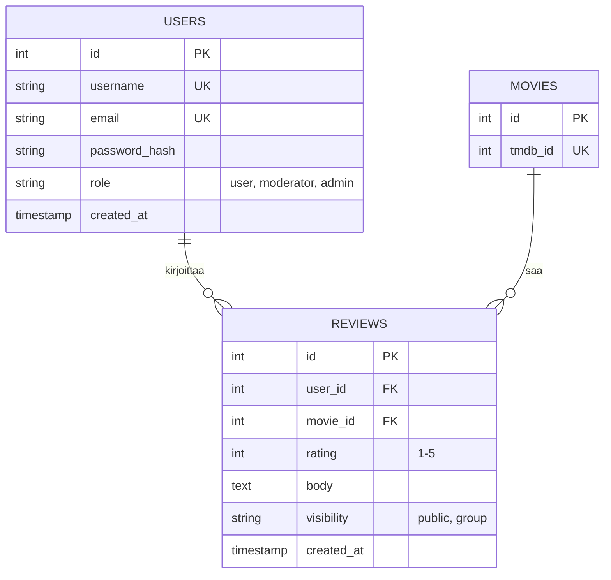
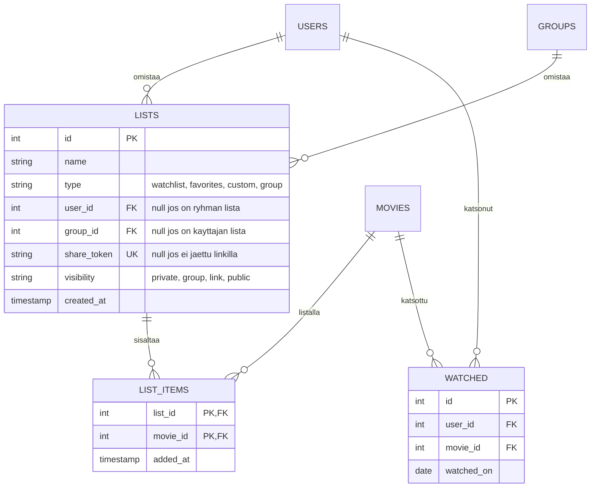

# Tietokannan ERD (Entity-Relationship Diagram)

Tila: Luonnos

## Ydin: Käyttäjät, elokuvat, arvostelut

## Ryhmat

## Listat ja katsotut

## Suunnittelupäätökset (ryhmän ehdotus, ei vahvistettu)

- Elokuvan tiedot haetaan ulkoisesta rajapinnasta (F5), joten MOVIES tallentaa vain rajapinnan tunnisteen. Tällä paikallinen rivi toimii arvostelujen viiteavaimena.
- Globaali rooli on USERS-taulussa (user, moderator, admin). Ryhmäkohtaiset roolit ovat GROUP_MEMBERS-taulussa.
- Yksi käyttäjä voi arvostella saman elokuvan vain kerran: lisätään UNIQUE (user_id, movie_id).
- Ryhmän jäsenyys on liitostaulussa GROUP_MEMBERS, jonka pääavain on (group_id, user_id). Näin sama käyttäjä voi kuulua useaan ryhmään, mutta samaan ryhmään vain kerran.
- Julkinen tai yksityinen ryhmä (F8, F17) on GROUPS.visibility-kentässä.
- Ryhmän ylläpidon automaattinen siirto, kun ainoa ylläpitäjä poistuu, toteutetaan sovelluslogiikassa, ei tietokannassa (ei vielä vaatimuksissa).
- Toivelista ja vakiolista ovat LISTS-taulussa tyypeillä watchlist ja favorites (ei vielä vaatimuksissa, F6 kattaa vain "käyttäjä voi tehdä listan"). Käyttäjälle luodaan ne rekisteröitymisen yhteydessä.
- Listan jakaminen linkillä (F21) toteutetaan share_token-kentällä: arvaamaton satunnainen merkkijono, jonka tietävä näkee listan ilman kirjautumista.
- Ryhmän yhteinen lista (F7) on LISTS-rivi, jolla group_id on asetettu. Muokkausoikeus (F31) tarkistetaan sovelluslogiikassa (S3).
- Katsotut ovat omassa WATCHED-taulussa (ei vielä vaatimuksissa), koska katsomispäivä kuuluu käyttäjän ja elokuvan väliseen suhteeseen. Sama elokuva voi olla katsottu useasti, joten (user_id, movie_id) ei ole yksilöllinen.
- Lista kuuluu joko käyttäjälle tai ryhmälle, ei molemmille (CHECK-ehto SQL-skeemassa).

## Avoimet kysymykset

- Sähköposti (salasanan palautus): ryhmä päätti lisätä email-kentän, koska salasanan palautus vaatii sen. Vaatimusmäärittelyn avoin kysymys koskee samaa asiaa, joten päätös viedään ryhmälle ja asiakkaalle.
- Jos arvostelu näkyy vain ryhmälle (F24), mille ryhmälle? Ehdotus: arvostelulle lisätään liitostaulu REVIEW_GROUPS (review_id, group_id), jolloin yksi arvostelu voi näkyä useammalle ryhmälle. Ratkaistaan ryhmän kanssa.
- Näkyvätkö listat haussa kaikille vai vain julkisiksi merkityt (ei vielä vaatimuksissa)? Ehdotus: vain julkiset listat näkyvät haussa.
  - Jos on ryhmän jäsen, näkyvätkö ryhmän listat haussa? Ehdotus: kyllä, jos käyttäjä on ryhmän jäsen.
