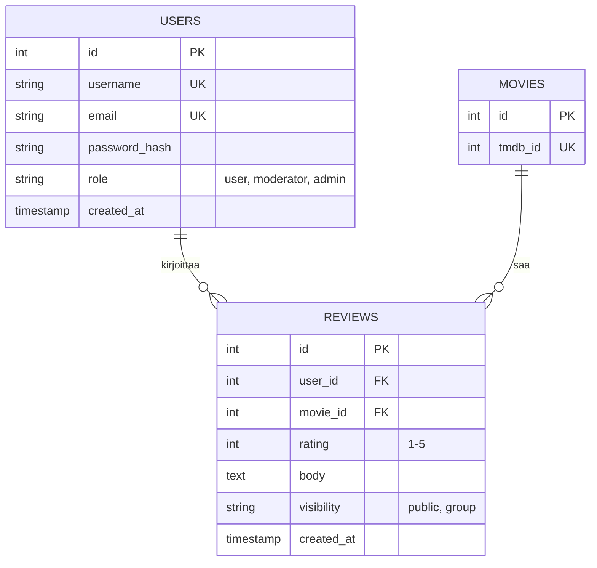
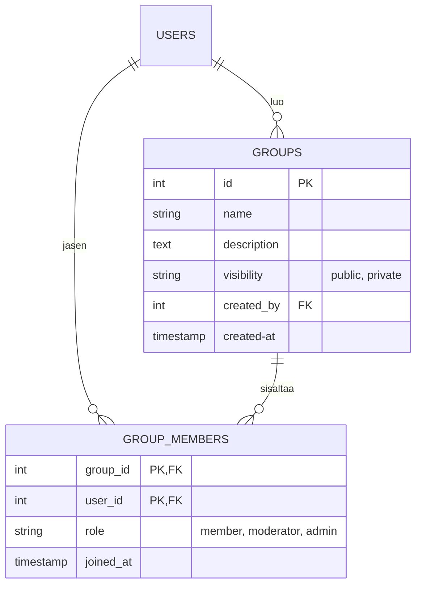

# Tietokannan ERD (Entity-Relationship Diagram)

Tila: Luonnos

## Ydin: Käyttäjät, elokuvat, arvostelut

## Ryhmat

## Suunnittelupäätökset (ryhmän ehdotus, ei vahvistettu)

- Elokuvan tiedot haetaan ulkoisesta rajapinnasta (F5), joten MOVIES tallentaa vain rajapinnan tunnisteen. Tällä paikallinen rivi toimii arvostelujen viiteavaimena.
- Globaali rooli on USERS-taulussa (user, moderator, admin). Ryhmäkohtaiset roolit tulevat ryhmien jäsentauluun myöhemmin.
- Yksi käyttäjä voi arvostella saman elokuvan vain kerran: lisätään UNIQUE (user_id, movie_id).
- Ryhmän jäsenyys on liitostaulussa GROUP_MEMBERS, jonka pääavain on (group_id, user_id). Näin sama käyttäjä voi kuulua useaan ryhmään, mutta samaan ryhmään vain kerran.
- Ryhmäkohtainen rooli (member, moderator, admin) on GROUP_MEMBERS-taulussa, globaali rooli USERS-taulussa. Ryhmän ylläpidon automaattinen siirto (F27) toteutetaan sovelluslogiikassa, ei tietokannassa.
- Julkinen tai yksityinen ryhmä (F25) on GROUPS.visibility-kentässä.

## Avoimet kysymykset

- Sähköposti (salasanan palautus): ryhmä päätti lisätä, koska salasanan palautus vaatii sen. Asiakkaalle ilmoitetaan katselmoinnissa. Samalla vaatimusmäärittelyyn kannattaa lisätä rivi, esim. F31 "Salasanan palautus sähköpostilla", jotta ERD:n email-kenttä vastaa vaatimusta.
- Jos arvostelu näkyy vain ryhmälle (F16), mille ryhmälle? Ehdotus: arvostelulle lisätään liitostaulu REVIEW_GROUPS (review_id, group_id), jolloin yksi arvostelu voi näkyä useammalle ryhmälle. Ratkaistaan ryhmän kanssa.
