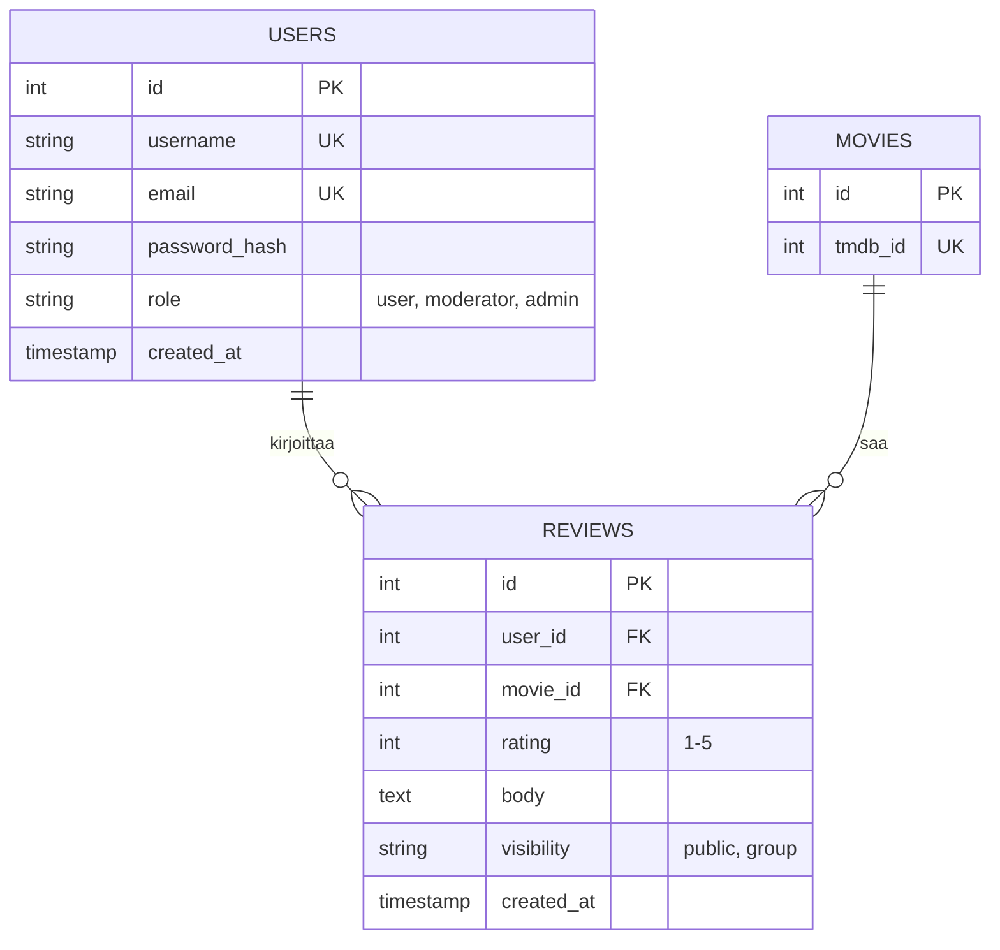

# Tietokannan ERD (Entity-Relationship Diagram)

Tila: Luonnos

## Ydin: Käyttäjät, elokuvat, arvostelut

## Suunnittelupäätökset (ryhmän ehdotus, ei vahvistettu)

- Elokuvan tiedot haetaan ulkoisesta rajapinnasta (F5), joten MOVIES tallentaa vain rajapinnan tunnisteen. Tällä paikallinen rivi toimii arvostelujen viiteavaimena.
- Globaali rooli on USERS-taulussa (user, moderator, admin). Ryhmäkohtaiset roolit tulevat ryhmien jäsentauluun myöhemmin.
- Yksi käyttäjä voi arvostella saman elokuvan vain kerran: lisätään UNIQUE (user_id, movie_id).

## Avoimet kysymykset

- Sähköposti (salasanan palautus): ryhmä päätti lisätä, koska salasanan palautus vaatii sen. Asiakkaalle ilmoitetaan katselmoinnissa. Samalla vaatimusmäärittelyyn kannattaa lisätä rivi, esim. F31 "Salasanan palautus sähköpostilla", jotta ERD:n email-kenttä vastaa vaatimusta.
- Jos arvostelu näkyy vain ryhmälle (F16), mille ryhmälle tarkalleen? Ratkaistaan, kun ryhmätaulut on piirretty.
