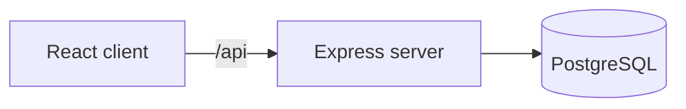

# Tekninen määrittely

Tila: luonnos. Päivitetään projektin edetessä.

## Teknologiat

- Frontend: React (Vite)
- Backend: Express (Node.js)
- Tietokanta: PostgreSQL
- Versionhallinta: GitHub
- Julkaisu: Azure (TBD)

## Arkkitehtuuri

## Tietokanta (ERD)

Tähän lisätään ERD-kaavio, kun se on suunniteltu. Esim dbdiagram.io:lla -> mermaid muotoon.

## API

| Metodi | Polku | Kuvaus | Tila |
|--------|-------|--------|------|
| GET | /api/health | Palvelimen tilan tarkistus | ehdotettu |

## Käyttöönotto

TBD (Azure)
